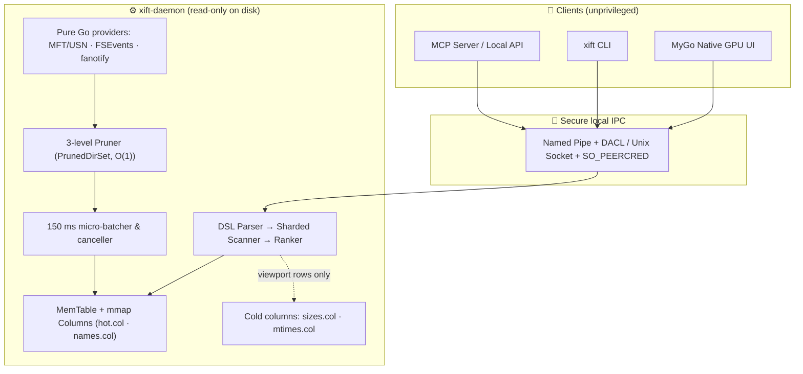
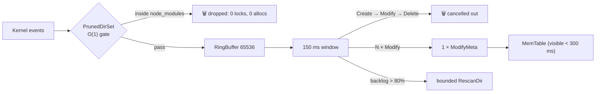

<div align="center">


# Xift

### ⚡ Sift a hundred million files in milliseconds. Cross-platform. Pure Go. Zero CGO.

**English** · [简体中文](README.zh-CN.md)

[](https://github.com/mr-dadong/Xift/actions/workflows/ci.yml)
[](https://github.com/mr-dadong/Xift/actions/workflows/release.yml)
[](go.mod)
[](LICENSE)
[](#-the-seven-iron-laws)
[](#-installation)
[](#-installation)

<br/>

<table>
<tr>
<td align="center" width="200"><h3>⚡ 3.62 ms</h3><sub>hot query over 1M nodes</sub></td>
<td align="center" width="200"><h3>🧠 0 allocs</h3><sub>10.24 ns per name match</sub></td>
<td align="center" width="200"><h3>🦫 0 lines of C</h3><sub>Pure Go, <code>CGO_ENABLED=0</code></sub></td>
</tr>
</table>

</div>

---

## 🤔 Why Xift?

Everything is legendary on Windows, but it's Windows-only, keeps the whole index in RAM, and fills your results with `node_modules` junk. Spotlight and `locate` are either slow, opaque, or stale.

**Xift is built differently:** a columnar, `mmap`-backed, zero-GC search engine that **refuses to index garbage in the first place**, works the same way on all three desktop OSes, and is designed to scale to **100M+ files under a fixed memory ceiling** without ever running out of memory.

<table>
<tr>
<td width="33%" valign="top">

### 🚀 Ridiculously fast
Multi-core sharded scanning over a 16-byte, pointer-free `HotNode` column. Incremental narrowing reuses the previous result set, so each keystroke costs **< 0.5 ms**.

</td>
<td width="33%" valign="top">

### 🧹 Noise-free by default
`node_modules`, `.git`, `target`, `.venv`, browser caches… pruned or **folded into a single directory node** right at the collector. Running `npm install` writes **zero** index entries.

</td>
<td width="33%" valign="top">

### 🪶 Featherweight
Hot/cold columnar split + `mmap` means file sizes and timestamps never enter RAM until they're about to be drawn on screen. The OS can reclaim index pages for free.

</td>
</tr>
<tr>
<td valign="top">

### 🌍 Truly cross-platform
NTFS MFT + USN Journal on Windows, `getattrlistbulk` + FSEvents on macOS, `getdents64` + `fanotify`/`inotify` on Linux, all in **Pure Go**.

</td>
<td valign="top">

### 🔒 Least privilege
The daemon is **strictly read-only** on your disk. All destructive operations happen in the unprivileged client. IPC is locked to the current user (DACL / `SO_PEERCRED`).

</td>
<td valign="top">

### 🧱 Never OOM
Below 5M files: `mmap` columns. Above that: an LSM + Trigram engine behind a **fixed-budget LRU block cache** (planned). RAM stays flat while your disk grows.

</td>
</tr>
</table>

---

## 📊 Benchmarks

> Measured with `CGO_ENABLED=0` on commodity desktop hardware. Reproduce them with the commands in [Development](#-development).

| Scenario | Result | Target |
| :--- | ---: | ---: |
| Hot query, full multi-core scan, **1,000,000 nodes** | **3.62 ms** | < 10 ms |
| Incremental narrowing (next keystroke) | **< 0.5 ms** | < 2 ms |
| Cold-column lookups per viewport | **1** | viewport only |
| ASCII case-fold match (`BenchmarkMatchASCIIFoldZeroAlloc`) | **10.24 ns/op · 0 B/op · 0 allocs/op** | 0 allocs |
| Cross-compile matrix (win/linux/darwin × amd64/arm64) | **6 / 6 green** | 6 / 6 |
| Data races under `-race` (storage / query / cli) | **0** | 0 |

### 🎯 Design SLAs

| Dimension | Tier 1 · ~1M effective files | Tier 2 · 100M files | Everything (reference) |
| :--- | :--- | :--- | :--- |
| Engine | Columnar hot column + `mmap` | LSM segments + Trigram + LRU | Full in-memory linear scan |
| Cold start | `< 0.5 s` | `< 1.0 s` | tens of seconds |
| First-keystroke latency | `5–10 ms` | `5–25 ms` | stutters at 100M |
| Change visible in results | `< 300 ms` | `< 300 ms` | ~100–500 ms |
| Daemon RSS | **~35–65 MB** | **hard cap, e.g. 128 MB** | ~240 MB / 6–10 GB |
| Idle / build-storm CPU | `~0.0%` / `< 0.5%` | `~0.0%` / `< 3%` | heavy re-indexing |

---

## 🏗️ Architecture



### 🧬 The 16-byte heart

```go
// HotNode: 16 bytes, no pointers, noscan; the GC never looks at it.
type HotNode struct {
    NameOff   uint32 // offset into names.col
    ParentIdx uint32 // parent directory NodeID
    NameLen   uint16 // UTF-8 length of the name
    Flags     uint16 // IsDir | Deleted | Hidden | Folded | System | ...
    ExtID     uint16 // interned extension → O(1) ext: filter
    VolID     uint16 // volume ID
}
```

Moving a directory with **500,000 children** means rewriting **one `uint32`**. Deleting a file in Tier 2 means flipping **one bit**.

### 🌪️ Storm-proof event pipeline



> `npm install` writes 80,000 files → **1** index record (the top-level `node_modules` folder). The other 79,999 events die at the gate.

---

## 🛡️ The Seven Iron Laws

| # | Law | What it buys you |
| :-: | :--- | :--- |
| 1 | **Dual-process privilege split** | Daemon is read-only; the UI does destructive ops as you |
| 2 | **Prune at the source, fold dependencies** | `HardExclude` / `Fold` / `SoftDemote`, intercepted in O(1) |
| 3 | **Columnar hot/cold split** | Names stay hot; sizes and mtimes stay on disk |
| 4 | **Adaptive dual-tier storage** | `mmap` below 5M files, LSM + Trigram + LRU above. Never OOM |
| 5 | **Zero-GC heap** | Flat, pointer-free (`noscan`) structures on every hot path |
| 6 | **Kernel push + 150 ms cancellation** | No polling, ever. Transient file storms cancel themselves out |
| 7 | **Viewport virtualization & zero CGO** | Clients fetch only the 50–100 visible rows; `import "C"` is banned |

---

## 📦 Installation

### Prebuilt binaries

Grab the archive for your platform from [**Releases**](https://github.com/mr-dadong/Xift/releases). Every asset ships with a `.sha256` and a combined `checksums.txt`.

| OS | amd64 | arm64 | Packages |
| :--- | :-: | :-: | :--- |
| 🪟 Windows | ✅ `.zip` | ✅ `.zip` | portable |
| 🍎 macOS | ✅ `.zip` | ✅ `.zip` | portable |
| 🐧 Linux | ✅ `.tar.gz` | ✅ `.tar.gz` | `.deb` · `.rpm` |

```bash
# Debian / Ubuntu
sudo dpkg -i xift_*_amd64.deb

# Fedora / RHEL / Rocky
sudo rpm -i xift-*.x86_64.rpm
```

### From source

```bash
go install github.com/mr-dadong/Xift/cmd/xift@latest
```

No C toolchain needed. Ever.

---

## 🚀 Quick Start

```bash
# 1. Build a read-only local index (pruning on by default)
xift index ~

# 2. Search
xift report 2026 ext:pdf,docx !draft

# 3. Inspect the index and the recommended storage tier
xift status
```

### 🔎 Query DSL cheat sheet

| Query | Meaning |
| :--- | :--- |
| `report 2026` | space = **AND** |
| `"*.go \| *.rs"` | `\|` = **OR**, wildcards `*` `?` |
| `ext:pdf,docx` | extension set, O(1) `ExtID` match |
| `size:>50mb dm:7d` | size / modified-date filters (cold columns, candidates only) |
| `path:src/engine` | match against the full path |
| `!node_modules !draft` | exclude |
| `(a \| b) c` | grouping |
| `type:file` / `type:dir` | node type |
| `in:node_modules lodash` | peek **inside** a folded dependency dir, on demand, no index pollution |
| `all:kernel32` / `sys:` | lift the system-file demotion |

### 🖥️ Desktop UI (`xift-ui`)

Start the daemon first, then launch the unprivileged native GPU UI:

```bash
# 1. Start the local read-only daemon
xift-daemon

# 2. Launch the desktop search UI (Launcher + Explorer + Tray)
xift-ui                 # starts in Launcher mode (default)
xift-ui -mode explorer  # starts in multi-column Explorer mode
xift-ui -mode tray      # starts resident in the system tray
```

| Binding | Action |
| :--- | :--- |
| `Alt+Space` | Global shortcut to focus/open **Launcher** quick-search panel |
| `Ctrl+Alt+Space` | Global shortcut to focus/open **Explorer** multi-column window |
| `↑` / `↓` | Move selection within retained search results |
| `Enter` | Open selected file with default OS application (also records Frecency) |
| `Ctrl+Enter` | Reveal selected file in OS file manager (also records Frecency) |
| `Tab` | Toggle non-blocking split preview pane (code/text, Markdown, images, `.zip`/`.tar.gz`, PDF metadata) |
| `Right-Click` | Open native context menu (Open, Reveal, Copy Path/Name, Preview, Fold Parent Dir, Exclude Path) |
| `Drag` | Drag a result row directly into external desktop apps |
| `Esc` | Hide window to tray (after 30 s hidden, the window worker exits to release GPU/driver memory while the tray host stays resident) |

**Platform notes:**
- **Windows**: Uses Win32 global hotkeys and notification-area tray. If another app holds a shortcut, Xift reports which binding failed and keeps the tray entry working.
- **macOS**: Uses menu bar tray and Cocoa global hotkeys. Grant Accessibility / Input Monitoring permission if macOS restricts global shortcuts; conflicting bindings are surfaced in the window banner.
- **Linux (X11 / Wayland)**: On X11, grabs keys directly; on Wayland, requests bindings through the `xdg-desktop-portal` GlobalShortcuts portal (declined or remapped bindings update the in-window notice). Tray uses StatusNotifierItem and falls back gracefully if no tray host is present.

### 🧰 Plays well with Unix

```bash
xift ext:log "size:>100mb" -0 | xargs -0 rm -i        # NUL-separated paths
xift "*.go" path:internal --count                    # just the number
xift dm:1d --jsonl | jq -r '.path'                   # stream JSON lines
xift ext:mp4 --sort size --desc --limit 10           # top 10 biggest videos
xift --daemon ext:go --limit 50                      # query the running daemon over IPC
```

<details>
<summary><b>All search flags</b></summary>

```text
--data-dir <dir>    Index data directory (default: $XIFT_DATA_DIR or user cache dir)
--daemon            Query running xift-daemon over secure local IPC (no local fallback)
--endpoint <addr>   Override Daemon IPC endpoint (used with --daemon)
--json              Output structured JSON result
--jsonl             Output newline-delimited JSON (one item per line)
-0, --zero          Separate paths with NUL byte instead of newline (for xargs -0)
-c, --count         Print total match count only
--limit <n>         Maximum results to return (default: 100)
--offset <n>        Result pagination offset (default: 0)
--sort <field>      Sort order: relevance | name | size | mtime (default: relevance)
--desc              Sort descending (for name/size/mtime)
--sep <char>        Path separator (default: OS native separator)
```

</details>

---

## 🗺️ Roadmap

| Phase | Scope | Status |
| :--- | :--- | :-: |
| **0 · Spike** | MyGo `ui.List` 3M-row stress demo · Pure Go MFT scan + two-pass pruning | ✅ |
| **1 · Tier 1 engine** | Columnar storage + `mmap` + MemTable + WAL · 3-level pruner · 3 OS providers · 150 ms batcher · query DSL · CLI | ✅ |
| **2 · Native UI** | Secure IPC & viewport RPC · Launcher + Explorer windows · Fuzzy / Pinyin / Frecency · icon atlas · native context menu & drag-out · previews | ✅ |
| **3 · 100M+ & ecosystem** | Tier 2 LSM + Trigram + fixed-budget LRU · full-text for whitelisted dirs · offline volume snapshots · MCP server | 🔭 |

---

## 🧑‍💻 Development

```bash
git clone https://github.com/mr-dadong/Xift.git && cd Xift

# Unit tests: always CGO-free
CGO_ENABLED=0 go test ./...

# Race detector (needs CGO only for the detector itself)
CGO_ENABLED=1 go test -race -count=1 ./internal/...

# Benchmarks
CGO_ENABLED=0 go test -run '^$' -bench . -benchmem ./internal/query/...
```

<details>
<summary><b>Repository layout</b></summary>

```text
Xift/
├── cmd/
│   ├── xift/              # CLI
│   ├── xift-daemon/       # background indexing daemon
│   └── xift-ui/           # MyGo native desktop UI (Launcher + Explorer)
├── internal/
│   ├── filter/            # 3-level pruning & dependency folding
│   ├── storage/           # columnar hot/cold storage, mmap, MemTable, WAL
│   ├── provider/          # Pure Go FS collectors (windows / darwin / linux) + 150 ms batcher
│   ├── query/             # DSL lexer/parser, sharded scanner, ranking, sessions
│   ├── ipc/               # secure local IPC & viewport RPC
│   ├── daemon/            # daemon lifecycle
│   ├── cli/               # CLI implementation
│   └── ui/                # MyGo native UI
└── assets/icons/          # app & tray icons
```

</details>

### 🤝 Contributing

PRs are welcome! Before you open one, please make sure:

- [ ] `CGO_ENABLED=0 go build ./...` and `go test ./...` pass
- [ ] No `import "C"`. The project stays Pure Go
- [ ] Hot paths stay allocation-free (check with `-benchmem`)
- [ ] New behavior comes with tests (red → green)
- [ ] The daemon never writes to user files

---

## 🙏 Acknowledgements

- [**MyGo**](https://github.com/egoist/mygo): a native GPU UI toolkit for Go
- [**purego**](https://github.com/ebitengine/purego): calling system libraries without CGO
- [**golang.org/x/sys**](https://pkg.go.dev/golang.org/x/sys): raw syscalls on every platform
- [**Everything**](https://www.voidtools.com/), the bar we're trying to clear

## 📄 License

[Apache License 2.0](LICENSE) © Xift contributors

<div align="center">

<br/>

**If Xift saved you a few milliseconds, consider leaving a ⭐**

<sub>Built with ❤️ and an unreasonable hatred of `node_modules`.</sub>

</div>
