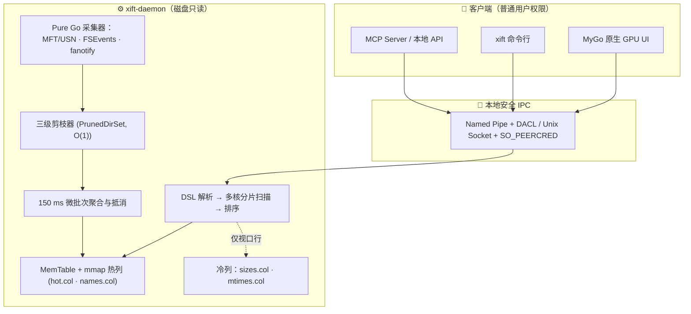
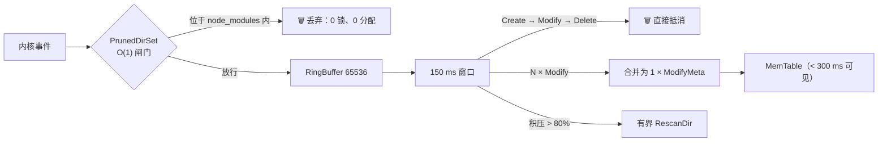

<div align="center">


# Xift

### ⚡ 亿级文件，毫秒直达：三端统一、Pure Go、零 CGO

[English](README.md) · **简体中文**

[](https://github.com/mr-dadong/Xift/actions/workflows/ci.yml)
[](https://github.com/mr-dadong/Xift/actions/workflows/release.yml)
[](go.mod)
[](LICENSE)
[](#️-七大架构铁律)
[](#-安装)
[](#-安装)

<br/>

<table>
<tr>
<td align="center" width="200"><h3>⚡ 3.62 ms</h3><sub>百万节点热查询</sub></td>
<td align="center" width="200"><h3>🧠 0 次分配</h3><sub>单次文件名匹配 10.24 ns</sub></td>
<td align="center" width="200"><h3>🦫 0 行 C 代码</h3><sub>Pure Go，<code>CGO_ENABLED=0</code></sub></td>
</tr>
</table>

</div>

---

## 🤔 为什么是 Xift？

Everything 在 Windows 上堪称传奇，但它只支持 Windows，全量索引常驻内存，搜索结果还会被 `node_modules` 之类的碎片淹没。Spotlight、`locate` 则不是慢、就是黑盒、要么索引过期。

**Xift 换了一条路：** 一个列式存储、`mmap` 驱动、零 GC 的搜索引擎，**从源头就拒绝收录垃圾**，三大桌面系统行为一致，并按 **1 亿+ 文件、固定内存上限、永不 OOM** 的目标设计。

<table>
<tr>
<td width="33%" valign="top">

### 🚀 快得离谱
在 16 字节、无指针的 `HotNode` 热列上做多核分片扫描；增量输入直接复用上次命中集，每次按键 **< 0.5 ms**。

</td>
<td width="33%" valign="top">

### 🧹 默认零噪声
`node_modules`、`.git`、`target`、`.venv`、浏览器缓存……在采集层直接剪枝，或**折叠成一个目录节点**。执行 `npm install` 时索引写入量为 **0**。

</td>
<td width="33%" valign="top">

### 🪶 轻如鸿毛
列式热冷分离加 `mmap`：文件大小和修改时间要等到真正渲染到屏幕上才会读进内存，索引页可以由操作系统零成本回收。

</td>
</tr>
<tr>
<td valign="top">

### 🌍 真·三端统一
Windows 用 NTFS MFT + USN Journal，macOS 用 `getattrlistbulk` + FSEvents，Linux 用 `getdents64` + `fanotify`/`inotify`，全部 **Pure Go**。

</td>
<td valign="top">

### 🔒 最小权限
守护进程对磁盘**严格只读**，所有破坏性操作都在普通权限的客户端里完成；IPC 只允许当前用户访问（DACL / `SO_PEERCRED`）。

</td>
<td valign="top">

### 🧱 永不 OOM
500 万文件以下走 `mmap` 列式扫描；超过后切换到 LSM + Trigram 倒排，外加**固定预算的 LRU 块缓存**（规划中）。磁盘里的文件越来越多，内存曲线保持平直。

</td>
</tr>
</table>

---

## 📊 性能实测

> 均在 `CGO_ENABLED=0` 下于普通桌面硬件实测，复现命令见[参与开发](#-参与开发)。

| 场景 | 实测 | 目标 |
| :--- | ---: | ---: |
| **100 万节点**热查询（多核全量扫描） | **3.62 ms** | < 10 ms |
| 增量窄化过滤（下一次按键） | **< 0.5 ms** | < 2 ms |
| 每个视口的冷列点查次数 | **1** | 仅视口 |
| ASCII 忽略大小写匹配（`BenchmarkMatchASCIIFoldZeroAlloc`） | **10.24 ns/op · 0 B/op · 0 allocs/op** | 0 分配 |
| 交叉编译矩阵（win/linux/darwin × amd64/arm64） | **6 / 6 全绿** | 6 / 6 |
| `-race` 竞态检测（storage / query / cli） | **0** | 0 |

### 🎯 设计 SLA

| 维度 | Tier 1 · 约 100 万有效文件 | Tier 2 · 1 亿文件 | Everything（参照） |
| :--- | :--- | :--- | :--- |
| 引擎模式 | 列式热列 + `mmap` | LSM 分段 + Trigram + LRU | 全内存线性扫描 |
| 冷启动 | `< 0.5 s` | `< 1.0 s` | 数十秒 |
| 首字延迟 | `5–10 ms` | `5–25 ms` | 1 亿规模卡顿 |
| 变更实时可见 | `< 300 ms` | `< 300 ms` | ~100–500 ms |
| 守护进程内存 | **~35–65 MB** | **硬上限，如 128 MB** | ~240 MB / 6–10 GB |
| 待机 / 编译风暴 CPU | `~0.0%` / `< 0.5%` | `~0.0%` / `< 3%` | 高频刷库 |

---

## 🏗️ 架构全景



### 🧬 16 字节的心脏

```go
// HotNode：16 字节、零指针、noscan，GC 完全不会扫描它
type HotNode struct {
    NameOff   uint32 // 在 names.col 中的偏移
    ParentIdx uint32 // 父目录 NodeID
    NameLen   uint16 // 文件名 UTF-8 长度
    Flags     uint16 // IsDir | Deleted | Hidden | Folded | System | ...
    ExtID     uint16 // 扩展名驻留 ID → ext: 过滤 O(1)
    VolID     uint16 // 所属卷 ID
}
```

移动一个含 **50 万子文件**的目录，只需改写 **1 个 `uint32`**；在 Tier 2 中删除一个文件，只需翻转 **1 个 bit**。

### 🌪️ 抗风暴事件流水线



> `npm install` 一口气写入 8 万个文件，最终只产生 **1** 条索引记录（顶层 `node_modules` 目录本身），其余 79,999 个事件都在闸门处被拦下。

---

## 🛡️ 七大架构铁律

| # | 铁律 | 带来什么 |
| :-: | :--- | :--- |
| 1 | **双进程权限解耦** | Daemon 只读磁盘，破坏性操作由普通权限 UI 执行 |
| 2 | **源头剪枝与依赖折叠** | `HardExclude` / `Fold` / `SoftDemote` 三级治理，O(1) 拦截 |
| 3 | **列式热冷分离** | 文件名常驻热列，大小和时间留在磁盘 |
| 4 | **自适应双模存储** | 500 万以下走 `mmap`，以上走 LSM + Trigram + LRU，永不 OOM |
| 5 | **零 GC 堆区** | 热路径全部使用扁平、无指针（`noscan`）结构 |
| 6 | **内核推送 + 150 ms 抵消** | 不轮询扫盘，瞬时文件风暴在窗口内自行抵消 |
| 7 | **视口虚拟化 & 零 CGO** | 客户端只拉取可见的 50~100 行；禁止 `import "C"` |

---

## 📦 安装

### 预编译二进制

从 [**Releases**](https://github.com/mr-dadong/Xift/releases) 下载对应平台的压缩包，每个资产都附带 `.sha256`，另有汇总的 `checksums.txt`。

| 系统 | amd64 | arm64 | 安装包 |
| :--- | :-: | :-: | :--- |
| 🪟 Windows | ✅ `.zip` | ✅ `.zip` | 免安装 |
| 🍎 macOS | ✅ `.zip` | ✅ `.zip` | 免安装 |
| 🐧 Linux | ✅ `.tar.gz` | ✅ `.tar.gz` | `.deb` · `.rpm` |

```bash
# Debian / Ubuntu
sudo dpkg -i xift_*_amd64.deb

# Fedora / RHEL / Rocky
sudo rpm -i xift-*.x86_64.rpm
```

### 从源码安装

```bash
go install github.com/mr-dadong/Xift/cmd/xift@latest
```

完全不需要 C 工具链。

---

## 🚀 快速上手

```bash
# 1. 建立只读本地索引（默认开启剪枝）
xift index ~

# 2. 搜索
xift report 2026 ext:pdf,docx !draft

# 3. 查看索引统计与推荐存储档位
xift status
```

### 🔎 查询 DSL 速查表

| 查询 | 含义 |
| :--- | :--- |
| `report 2026` | 空格即 **AND** |
| `"*.go \| *.rs"` | `\|` 即 **OR**，支持通配符 `*` `?` |
| `ext:pdf,docx` | 扩展名集合，O(1) `ExtID` 比对 |
| `size:>50mb dm:7d` | 大小 / 修改时间过滤（只对候选集点查冷列） |
| `path:src/engine` | 匹配完整路径 |
| `!node_modules !draft` | 排除 |
| `(a \| b) c` | 分组 |
| `type:file` / `type:dir` | 节点类型 |
| `in:node_modules lodash` | 按需**深入**被折叠的依赖目录检索，不污染常驻索引 |
| `all:kernel32` / `sys:` | 解除系统文件降权 |

### 🖥️ 桌面 UI（`xift-ui`）

先启动本地只读守护进程，再以普通用户权限启动原生 GPU 桌面 UI：

```bash
# 1. 启动本地只读守护进程
xift-daemon

# 2. 启动桌面搜索 UI（Launcher 快搜窗 + Explorer 主窗 + 系统托盘）
xift-ui                 # 默认以 Launcher 快搜窗启动
xift-ui -mode explorer  # 以四列 Explorer 主窗启动
xift-ui -mode tray      # 仅驻留系统托盘，按需唤起
```

| 快捷键 | 操作 |
| :--- | :--- |
| `Alt+Space` | 全局唤起 / 聚焦 **Launcher** 悬浮快搜窗 |
| `Ctrl+Alt+Space` | 全局唤起 / 聚焦 **Explorer** 四列主窗 |
| `↑` / `↓` | 在可浏览结果范围内上下选择 |
| `Enter` | 使用系统默认应用打开所选文件（同步更新 Frecency 排序权重） |
| `Ctrl+Enter` | 在系统文件管理器中定位所选文件目录（同步更新 Frecency 排序权重） |
| `Tab` | 开关右侧非阻塞内置预览（文本/代码/Markdown、图片缩略图、`.zip`/`.tar.gz` 目录头、PDF 元信息） |
| `右键` | 弹出原生右键菜单（打开、定位目录、复制路径/文件名、开关预览、折叠所属目录、永久排除此路径） |
| `拖拽` | 将结果行直接拖出到外部编辑器、聊天软件或文件管理器 |
| `Esc` | 隐藏窗口到托盘（连续全隐藏满 30 秒后窗口渲染子进程自动退出，彻底归还 GPU 与显卡驱动内存，零 GPU 托盘宿主保持常驻） |

**平台要求与说明：**
- **Windows**：使用系统全局热键与通知区域托盘。若快捷键被其他软件占用，窗口会明确提示冲突绑定，托盘入口保持可用。
- **macOS**：使用菜单栏托盘与系统全局快捷键。如遇系统权限限制或快捷键冲突，窗口提示条会明确展示受影响的绑定。
- **Linux（X11 / Wayland）**：X11 下直接注册热键；Wayland 下通过 `xdg-desktop-portal` GlobalShortcuts 请求授权，用户拒绝或改键后状态提示会同步更新。托盘使用 StatusNotifierItem，无托盘宿主时自动降级保留窗口入口。

### 🧰 Unix 管道友好

```bash
xift ext:log "size:>100mb" -0 | xargs -0 rm -i        # NUL 分隔路径
xift "*.go" path:internal --count                    # 只要数量
xift dm:1d --jsonl | jq -r '.path'                   # 流式 JSON 行
xift ext:mp4 --sort size --desc --limit 10           # 最大的 10 个视频
xift --daemon ext:go --limit 50                      # 通过 IPC 查询运行中的守护进程
```

<details>
<summary><b>全部搜索参数</b></summary>

```text
--data-dir <dir>    索引数据目录（默认：$XIFT_DATA_DIR 或用户缓存目录）
--daemon            通过本地安全 IPC 查询运行中的 xift-daemon（不回退本地）
--endpoint <addr>   覆盖 Daemon IPC 端点（配合 --daemon）
--json              输出结构化 JSON
--jsonl             输出逐行 JSON（每行一条）
-0, --zero          以 NUL 字节分隔路径（配合 xargs -0）
-c, --count         仅输出匹配总数
--limit <n>         最大返回条数（默认 100）
--offset <n>        分页偏移（默认 0）
--sort <field>      排序：relevance | name | size | mtime（默认 relevance）
--desc              降序（用于 name/size/mtime）
--sep <char>        路径分隔符（默认系统原生）
```

</details>

---

## 🗺️ 路线图

| 阶段 | 范围 | 状态 |
| :--- | :--- | :-: |
| **0 · 技术 Spike** | MyGo `ui.List` 300 万行压测 · Pure Go MFT 扫描与两阶段剪枝 | ✅ |
| **1 · Tier 1 引擎** | 列式存储 + `mmap` + MemTable + WAL · 三级剪枝 · 三端采集器 · 150 ms 批处理 · 查询 DSL · CLI | ✅ |
| **2 · 原生 UI** | 安全 IPC 与视口分页 RPC · Launcher 浮窗 + Explorer 主窗 · 模糊 / 拼音 / Frecency · 图标图集 · 原生右键与拖拽 · 内置预览 | ✅ |
| **3 · 亿级与生态** | Tier 2 LSM + Trigram + 固定预算 LRU · 白名单目录全文 · 离线卷快照 · MCP Server | 🔭 |

---

## 🧑‍💻 参与开发

```bash
git clone https://github.com/mr-dadong/Xift.git && cd Xift

# 单元测试（始终零 CGO）
CGO_ENABLED=0 go test ./...

# 竞态检测（仅竞态检测器本身需要 CGO）
CGO_ENABLED=1 go test -race -count=1 ./internal/...

# 基准测试
CGO_ENABLED=0 go test -run '^$' -bench . -benchmem ./internal/query/...
```

<details>
<summary><b>目录结构</b></summary>

```text
Xift/
├── cmd/
│   ├── xift/              # 命令行
│   ├── xift-daemon/       # 后台索引守护进程
│   └── xift-ui/           # MyGo 原生桌面 UI（Launcher + Explorer）
├── internal/
│   ├── filter/            # 三级剪枝与依赖折叠
│   ├── storage/           # 列式热冷存储、mmap、MemTable、WAL
│   ├── provider/          # Pure Go 三端采集器 + 150 ms 批处理
│   ├── query/             # DSL 解析、分片扫描、排序、会话
│   ├── ipc/               # 本地安全 IPC 与视口 RPC
│   ├── daemon/            # 守护进程生命周期
│   ├── cli/               # 命令行实现
│   └── ui/                # MyGo 原生 UI
└── assets/icons/          # 应用与托盘图标
```

</details>

### 🤝 贡献指南

欢迎提 PR！提交前请确认：

- [ ] `CGO_ENABLED=0 go build ./...` 与 `go test ./...` 通过
- [ ] 没有 `import "C"`，项目始终保持 Pure Go
- [ ] 热路径保持零分配（用 `-benchmem` 验证）
- [ ] 新行为附带测试（先红后绿）
- [ ] 守护进程绝不写入用户文件

---

## 🙏 致谢

- [**MyGo**](https://github.com/egoist/mygo)：Go 原生 GPU UI 工具包
- [**purego**](https://github.com/ebitengine/purego)：无需 CGO 调用系统库
- [**golang.org/x/sys**](https://pkg.go.dev/golang.org/x/sys)：全平台底层系统调用
- [**Everything**](https://www.voidtools.com/)，我们努力超越的标杆

## 📄 许可证

[Apache License 2.0](LICENSE) © Xift contributors

<div align="center">

<br/>

**如果 Xift 帮你省下了几毫秒，欢迎点个 ⭐**

<sub>用 ❤️ 和对 `node_modules` 毫无道理的憎恨打造。</sub>

</div>
